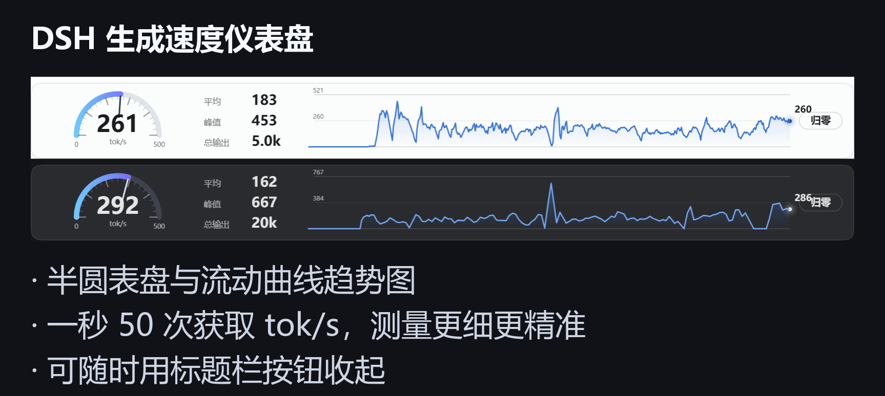
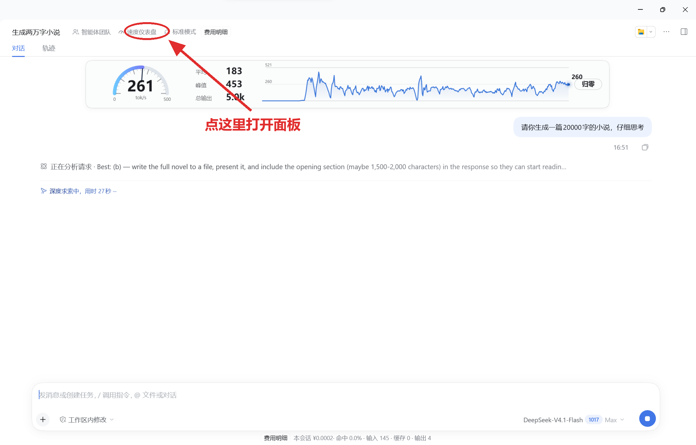
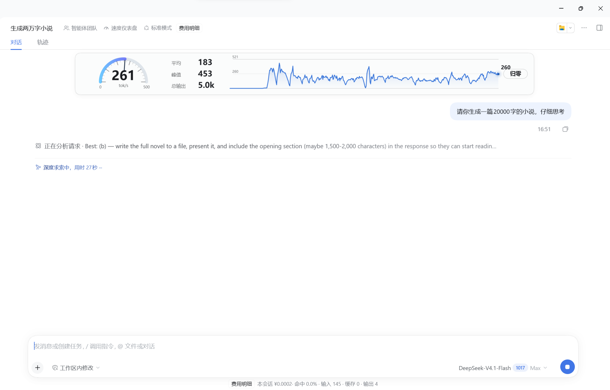
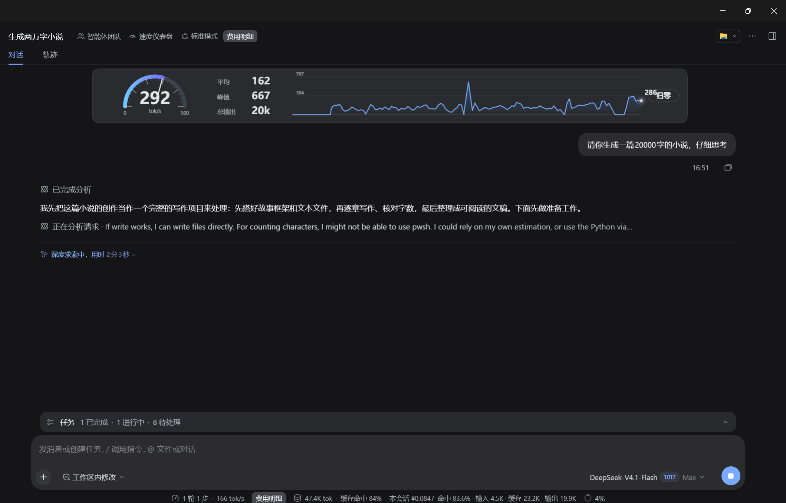

中文 | [English](README.en.md)

# dsh-speed-gauge

给 DSH 加一个生成速度仪表盘。装在标题栏，点一下展开，实时看当前会话输出有多快。

**每秒 50 次获取 tok/s**：逐 chunk 计数，测量更细更精准；主线程卡顿也不掉帧。



## 主要功能

- **实时速度**：0–500 tok/s 半圆表盘，指针平滑跟随
- **30 秒曲线**：连续左移的流动趋势图，能看清速度的起伏
- **平均 / 峰值**：都按最近 30 秒统计，峰值滑出窗口自动回落
- **总输出**：优先用官方 usage 的 outputTokens
- **按会话隔离**：切到别的会话或子代理，面板跟着切
- **不占地方**：面板浮在会话内容列顶部，宽度跟随内容列；标题栏按钮可随时收起
- **配色跟随宿主**：深色界面浅字，浅色界面深字

## 安装

### 插件市场

**暂未上架**，等上架后可以直接在市场里搜 `dsh-speed-gauge`。现在请用下面的方式安装。

### 方式一：GitHub Releases 下载安装包（推荐）

到 [Releases](https://github.com/MoreanP2003/dsh-speed-gauge/releases) 下载 `dsh-speed-gauge-1.0.0.tgz`，然后：

```bash
dsh plugin --profile desktop add ./dsh-speed-gauge-1.0.0.tgz
```

### 方式二：克隆仓库后安装

```bash
git clone https://github.com/MoreanP2003/dsh-speed-gauge.git
dsh plugin --profile desktop add ./dsh-speed-gauge
```

### 方式三：npm（一条命令）

```bash
dsh plugin --profile desktop add dsh-speed-gauge
dsh plugin --profile web add dsh-speed-gauge
```

包页面：https://www.npmjs.com/package/dsh-speed-gauge

### 桌面端注意

桌面应用请用它自带的 CLI，普通 `dsh` 命令管不了 `desktop` profile：

```bash
"<安装目录>\resources\runtime\cli\bin\dsh.cmd" plugin --profile desktop add <包或目录>
```

安装完在应用里重载一次（或重启）即可看到标题栏按钮。

### 更新 / 卸载

```bash
dsh plugin --profile desktop add <包或目录>
dsh plugin --profile desktop remove dsh-speed-gauge
```

## 使用

装好后标题栏会多出一个「速度仪表盘」按钮，点它就展开面板，再点收起（状态会记住）。



面板右侧的「归零」清空当前会话的累计值与峰值。

| 浅色 | 深色 |
|---|---|
|  |  |

## 数据口径

- 字符数来自 `llm/stream` 的增量：正文、思考正文、工具调用参数；
- 实时速度 = 字符率 ÷ 每 token 字符数，比例系数用官方 `usage.outputTokens` 在线标定；
- 总输出以官方 usage 累加为准，没有 usage 的流按字符数估算；
- 曲线、平均、峰值都用 30 秒窗口。

## 兼容性

- **DSH >= 0.2.1**（在 0.2.1-rc.2 上开发与验证），需要宿主提供 `webServer` 服务与 `llm/stream` 钩子
- Node.js >= 20
- React 18，由宿主提供，不重复打包
- 面板用 Worker + OffscreenCanvas 绘制；页面 CSP 不允许 Blob Worker 时自动退回一行文字
- 所有 DOM 类名以 `dsg-` 开头，只操作自己创建的节点，可与其它插件共存

### 网页版 / 远程访问

自定义路由默认只接受回环地址。走网页版或反向代理时，在启动 DSH 的环境里设置：

```bash
DSH_SPEED_GAUGE_ALLOW_REMOTE=1
```

### 调试

采样日志默认关闭。需要时设 `DSH_SPEED_GAUGE_LOG=1`，日志写到系统临时目录。

## 开发

```bash
node --test test/sampler.test.mjs test/host.test.mjs
```

| 文件 | 作用 |
|---|---|
| `host.js` | 监听 `llm/stream`，提供 SSE 与快照接口 |
| `sampler.js` | 采样与统计，纯逻辑、可单测 |
| `client.js` | 标题栏按钮 + 面板容器 |
| `panel-worker.js` | 面板绘制（Worker + OffscreenCanvas） |

## 许可证

MIT
